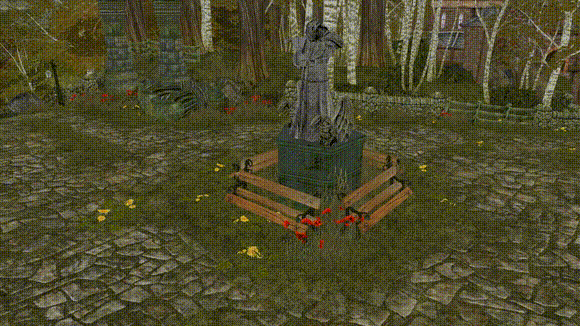

# OpenAlbion

This is a work-in-progress remake of [Fable (2004)](https://en.wikipedia.org/wiki/Fable_(2004_video_game))'s game engine. It's written in [Rust](https://rust-lang.org/) and uses the [wgpu](https://github.com/gfx-rs/wgpu) graphics API.

The def compiler and def-format library originally split out as [fable-defs](https://github.com/jamen/fable-defs) now live in [`packages/`](packages) (`defs`, `defs-derive`, `def-compiler`, `defc`, `def-compiler-sys`). The C++ port used by the comprehensive [EgoCore](https://github.com/eeeeeAeoN/EgoCore) modding tool lives in [`EgoCore/FableDefs`](https://github.com/eeeeeAeoN/EgoCore/tree/master/FableDefs).

Come visit the [Fable Modders' Guild](https://discord.gg/xUYzkCw) Discord server to discuss the project.
