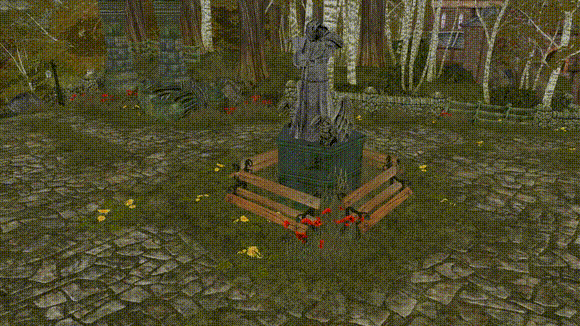

# OpenAlbion

This is a work-in-progress remake of [Fable (2004)](https://en.wikipedia.org/wiki/Fable_(2004_video_game))'s game engine. It's written in [Rust](https://rust-lang.org/) and uses the [wgpu](https://github.com/gfx-rs/wgpu) graphics API.

This is also a home for other Fable modding experiments. See [fable-defs](https://github.com/jamen/fable-defs) which was split off from this and is now used by the comprehensive [EgoCore](https://github.com/eeeeeAeoN/EgoCore) modding tool.

Come visit the [Fable Modders' Guild](https://discord.gg/xUYzkCw) Discord server to discuss the project.
